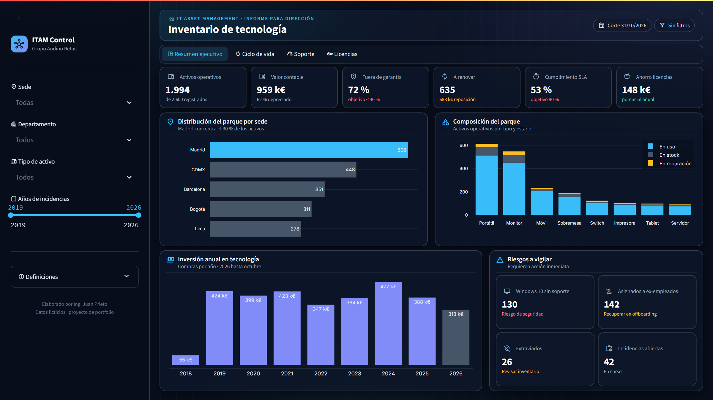

# 🛰️ Inventario de Tecnología (IT Asset Management)

> Dashboard ejecutivo para que la dirección de IT de una empresa multinacional decida **qué equipos renovar, dónde falla el soporte y cuánto se puede ahorrar en licencias** de cara al presupuesto 2027.
> El mismo caso resuelto en **Power BI** y en **Python (Streamlit)**.

🔗 **[Ver la app en vivo](https://itam-juanprieto.streamlit.app)**


<!-- Guarda capturas en la carpeta img/ con estos nombres, o cambia las rutas. -->

---

## 🎯 Contexto

*Grupo Andino Retail* (empresa ficticia) tiene 650 empleados en 5 sedes de España y Latinoamérica y unos 2.600 activos tecnológicos. El responsable de IT necesita responder:

1. ¿Cuál es el estado y el valor actual del parque tecnológico?
2. ¿Qué equipos hay que renovar en 2027 y cuánto costará?
3. ¿Qué modelos y qué sedes generan más problemas de soporte?
4. ¿Cuánto dinero se va en licencias que nadie usa?

## 📊 Principales hallazgos

- **72 %** del parque operativo está fuera de garantía, y los ~472 k€ en reparaciones vienen todos de esos equipos.
- **635 equipos** han superado su vida útil (688 k€ de reposición); **Operaciones** tiene el 50 % de su parque en esa situación.
- Los portátiles **Valtek Básica** generan ~2,8 veces más incidencias que el resto → retirarlos del catálogo de compra.
- **Lima** tarda ~118 h de media en resolver incidencias (63–75 h en el resto) y solo cumple el SLA en el 24 % de los casos.
- **130 equipos** siguen con Windows 10 sin soporte y **142 activos** siguen asignados a empleados que ya no están.
- Se pueden ahorrar **~148 k€/año (15 %)** ajustando licencias infrautilizadas.

## 🛠️ Qué incluye

| Parte | Tecnología | Detalle |
|---|---|---|
| **Datos** | PowerShell | Generador reproducible (semilla fija) de 8 tablas con patrones de negocio realistas |
| **Power BI** | Power Query, DAX, PBIP/TMDL | Modelo en estrella, relación inactiva con `USERELATIONSHIP`, +40 medidas (depreciación, SLA, time intelligence, ahorro), 5 páginas con navegación |
| **App web** | Python, pandas, Plotly, Streamlit | Tema oscuro ejecutivo, filtros, KPIs, títulos dinámicos, diseño que cabe en una pantalla y se adapta a móvil |

## 📂 Estructura

```
├── datos/                  CSV ficticios (8 tablas)
├── generar_datos.ps1       Genera los CSV
├── streamlit_app/          App web (app.py, requirements.txt, tema)
├── ITAM_PowerBI/           Proyecto Power BI (.pbip): modelo TMDL + informe PBIR
├── construir_pbip.ps1      Regenera el informe y ajusta la ruta de datos
├── tema_itam.json          Tema de Power BI
├── GUIA_POWER_BI.md        Guía paso a paso: modelo, DAX y diseño
└── img/                    Capturas para este README
```

## ▶️ Cómo ejecutarlo

**App Streamlit**
```bash
cd streamlit_app
pip install -r requirements.txt
streamlit run app.py
```

**Power BI**
1. Ejecuta `powershell -ExecutionPolicy Bypass -File .\construir_pbip.ps1` para apuntar el modelo a tu carpeta `datos`.
2. Abre `ITAM_PowerBI/ITAM.pbip` con Power BI Desktop y pulsa **Actualizar**.

---

*Datos 100 % ficticios generados para este proyecto. Fecha de corte: 31/10/2026.*
**Autor:** Ing. Juan Prieto · [LinkedIn](#) · [Portfolio](#)
